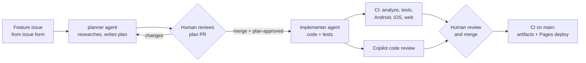

# local-stores-product-ordering

A Flutter storefront that lets local stores browse products and build wholesale orders.
It targets Android, iOS, and web.

**Live web preview:** https://sabajamalian.github.io/local-stores-product-ordering/

## Storefront

The responsive catalog has bundled product photos, searchable descriptions,
category filters, and a product-detail sheet. Choose a quantity before adding to the cart,
then adjust quantities or remove products from the cart. Prices and quantities are per
case or box, not per individual bottle or pack.

Products may require a minimum order quantity (default: 1 case or box). Higher
minimums are shown on product cards, in details, and in the cart. Cola requires
2 cases, Still Water 3 cases, and Potato Chips 2 boxes; other sample products
require 1. Card and detail selectors start at the minimum and cannot go below it.
The cart raises a first addition to at least the minimum; later additions add the
chosen count. Decrementing a cart line at its minimum removes the whole line.
Checkout blocks any line below its minimum and asks you to update or remove it.

The five product photos in `assets/products/` work offline and don't
depend on an external image service at runtime. They show product types, not the exact
brand, packaging, or pack size being ordered.
Add `description`, `category`, and `imageAsset` to a catalog entry in
`lib/models/product.dart` to supply its details and image.

### Photo sources

The catalog photos are from Unsplash and used under the
[Unsplash License](https://unsplash.com/license).
These are bundled editorial examples, not supplier-provided product photography.

| Asset | Source |
| --- | --- |
| Cola | [Original photo](https://images.unsplash.com/photo-1622483767028-3f66f32aef97) |
| Water | [Original photo](https://images.unsplash.com/photo-1523362628745-0c100150b504) |
| Orange juice | [Original photo](https://images.unsplash.com/photo-1600271886742-f049cd451bba) |
| Snacks | [Original photo](https://images.unsplash.com/photo-1566478989037-eec170784d0b) |
| Cookies | [Original photo](https://images.unsplash.com/photo-1499636136210-6f4ee915583e) |

This is an in-memory demo. Checkout shows a confirmation and clears the cart; it doesn't
send orders, take payment, or arrange delivery. Cart contents reset when the app restarts.

## How work flows in this repo

Features go from issue to production through Copilot agents, with humans approving at each
gate:



1. File a **Feature request** issue. Assign it to Copilot and choose the `planner` agent.
2. The planner opens a PR with a plan in `docs/plans/`. Review it, ask for changes in PR
   comments, then merge it and add the `plan-approved` label to the issue.
3. Assign the issue to Copilot again and choose the `implementer` agent. It builds from the
   merged plan and opens a PR that closes the issue.
4. CI runs and Copilot code review comments on the PR. A human approves and merges.
5. The push to `main` builds the Android and iOS artifacts and deploys the web preview.

Agent behavior comes from these files:

| File | Used by | Purpose |
| --- | --- | --- |
| `.github/instructions/org-standards.instructions.md` | All | Contoso Retail org standards (simulated in-repo) |
| `.github/copilot-instructions.md` | All | Repo architecture, build, and conventions |
| `.github/instructions/{dart,tests,workflows}.instructions.md` | All, by path | Rules for specific folders |
| `.github/instructions/code-review.instructions.md` | Copilot code review | Review checklist |
| `.github/agents/planner.agent.md` | Planner | Research and plan only |
| `.github/agents/implementer.agent.md` | Implementer | Build from an approved plan |
| `.github/workflows/copilot-setup-steps.yml` | Cloud agent | Installs Flutter for agent sessions on Actions |
| `docs/plans/TEMPLATE.md` | Planner | Required plan format |

## What happens on every push to `main`

The [CI workflow](.github/workflows/ci.yml) runs these jobs on GitHub-hosted runners:

| Job | Runner | What it does |
| --- | --- | --- |
| Analyze and unit tests | Ubuntu | `flutter analyze` and `flutter test` |
| Android emulator | Ubuntu (KVM) | Builds a debug APK, boots an Android 14 emulator, runs the integration test |
| iOS simulator | macOS | Builds for the iOS Simulator, boots an iPhone simulator, runs the integration test |
| Web build | Ubuntu | `flutter build web` |
| Deploy web preview | Ubuntu | Publishes the web build to GitHub Pages once every other job passes |

Pull requests run the same checks but don't deploy.

### Where to find results

Open a run under the **Actions** tab. The run summary has these artifacts:

- `android-build`: `app-debug.apk` (install with `adb install`)
- `ios-simulator-build`: `Runner-simulator.zip` (unzip, then `xcrun simctl install booted Runner.app`)
- `android-screenshots` and `ios-screenshots`: four PNGs captured during the integration
  test on each platform: catalog, product details, cart, and order confirmation

The mobile jobs require all four screenshots. If a test fails, any screenshots captured
before the failure are still uploaded.

### Limits

GitHub can build the apps and run tests on an emulator or simulator, but it can't stream an
interactive Android or iOS device to your browser. The GitHub Pages site is the web build of the
same Flutter code, so use it to click through the app. Platform-specific behavior still needs
the emulator/simulator test results or a real device.

The iOS build is unsigned and runs only in the Simulator. Installing on a physical iPhone or
shipping to TestFlight requires an Apple Developer account and code-signing secrets.

## Run locally

```sh
flutter pub get
flutter test                      # unit and widget tests
flutter run                       # pick a device or emulator
flutter run -d chrome             # web

# Integration test with screenshots saved to build/screenshots/
flutter drive --driver=test_driver/integration_test.dart \
  --target=integration_test/app_test.dart -d <device-id>
```

## Project layout

```
lib/
  main.dart                      app entry, provides the Cart
  models/product.dart            Product model and sample catalog
  state/cart.dart                Cart (ChangeNotifier)
  screens/product_list_screen.dart
  screens/cart_screen.dart
  widgets/                       shared product images and quantity controls
assets/products/                 bundled representative product photos
test/                            unit and widget tests
integration_test/app_test.dart   end-to-end flow run on emulator and simulator
test_driver/integration_test.dart  saves screenshots from flutter drive
docs/plans/                      approved implementation plans
.github/agents/                  Copilot custom agents (planner, implementer)
.github/instructions/            org, path-specific, and code review instructions
```
